<p align="center"></p>

<h1 align="center">Forma</h1>

<p align="center"><b>NURBS CAD in Python: 2D drafting, 3D modeling, parametric components, and a node editor with
daylight, energy and space-syntax analysis.</b><br>Runs on macOS, Windows and Linux. Created by Hatef Jafari Sharami.</p>

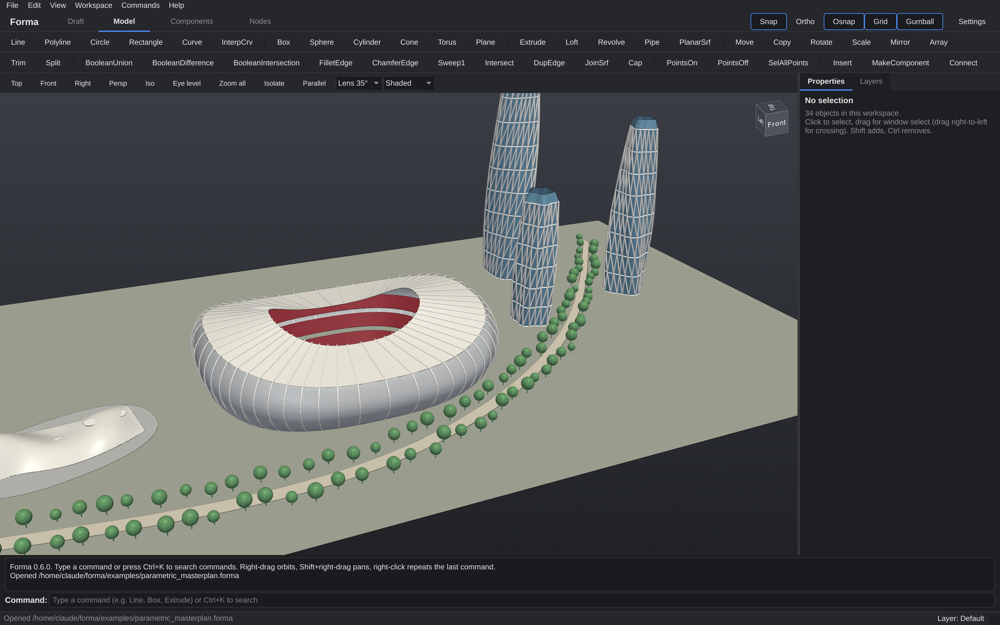

## Install in 3 steps

1. **Download** this repository: the green **Code** button → **Download ZIP**. Unzip it anywhere.
2. **Double-click the start file** for your computer:
   - macOS: `start_mac.command`
   - Windows: `start_windows.bat`
   - Linux: `start_linux.sh`
3. **Wait for the first setup** (5 to 10 minutes, about 1 GB download). After that Forma opens in seconds.

You don't need to install Python yourself. The step-by-step guide for every
system, and fixes for common problems, is in **[INSTALL.md](INSTALL.md)**.

Then open **`examples/sample_project.forma`** (File → Open) to see everything at once: drawings, NURBS
solids and surfaces, components and an analysis graph.

## Four workspaces, one model

| Workspace | Shortcut | What it is |
|---|---|---|
| **Draft** | Ctrl+1 | 2D drafting of the same model, seen from Top, Bottom, Front, Back, Left or Right. You draw on that view's plane |
| **Model** | Ctrl+2 | The 3D model: perspective, isometric (4 corners), eye-level two-point perspective, parallel on/off, lens, ViewCube |
| **Components** | Ctrl+3 | The same 3D model with the component library on the left and parameters/connectors on the right |
| **Nodes** | Ctrl+4 | The same 3D model with the node graph underneath: parametric design and analysis, results drawn live in 3D |

All four share one document, layers, undo history and the command line. (On a Mac, Ctrl in shortcuts is Cmd.)

| | |
|---|---|
| 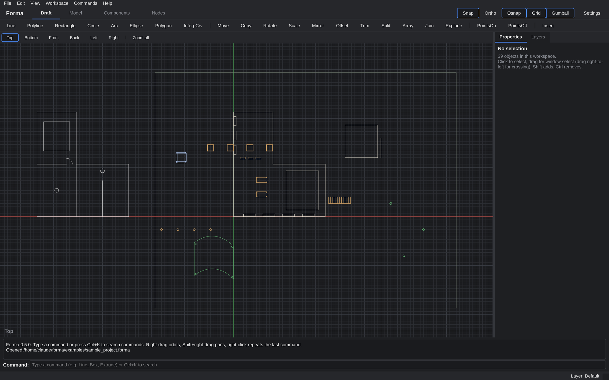 **Draft**, top view | 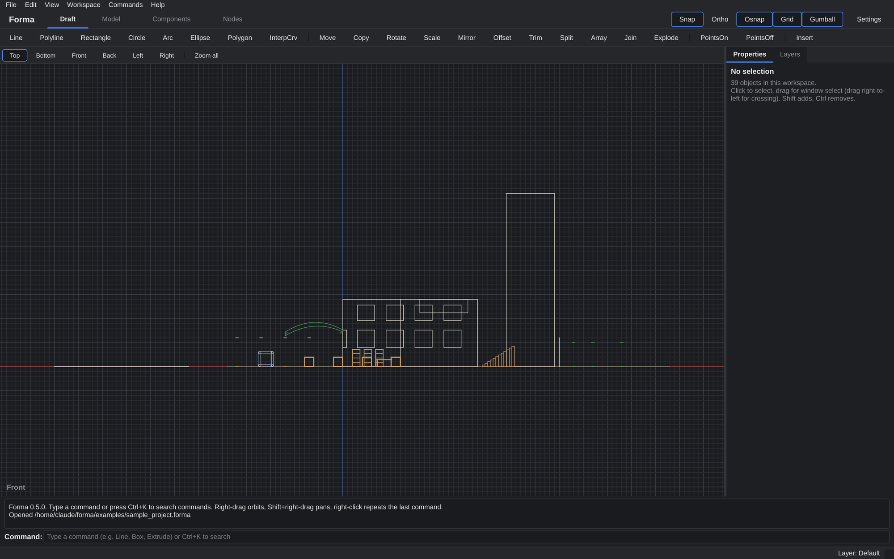 **Draft**, front view |
| 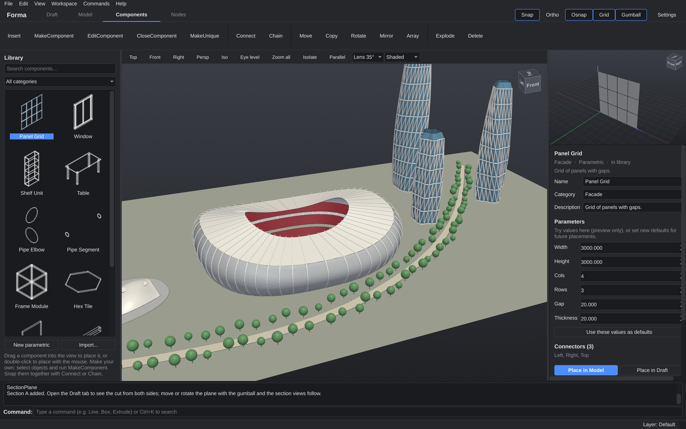 **Components**, parametric library | 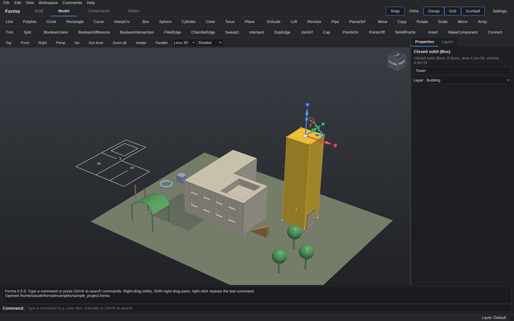 **Sub-object editing**: a face picked with Cmd/Ctrl+Shift-click |
| 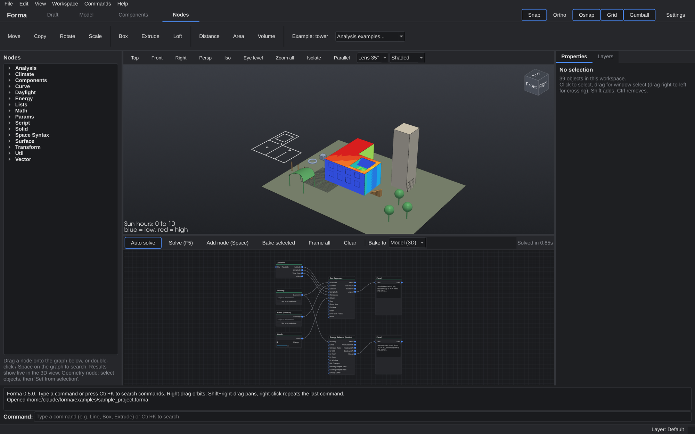 **Nodes**: sun hours with shading, energy report | 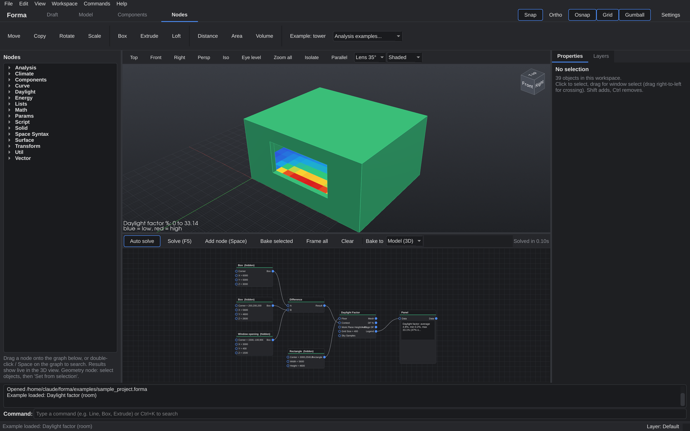 **Daylight factor** of a room |
| 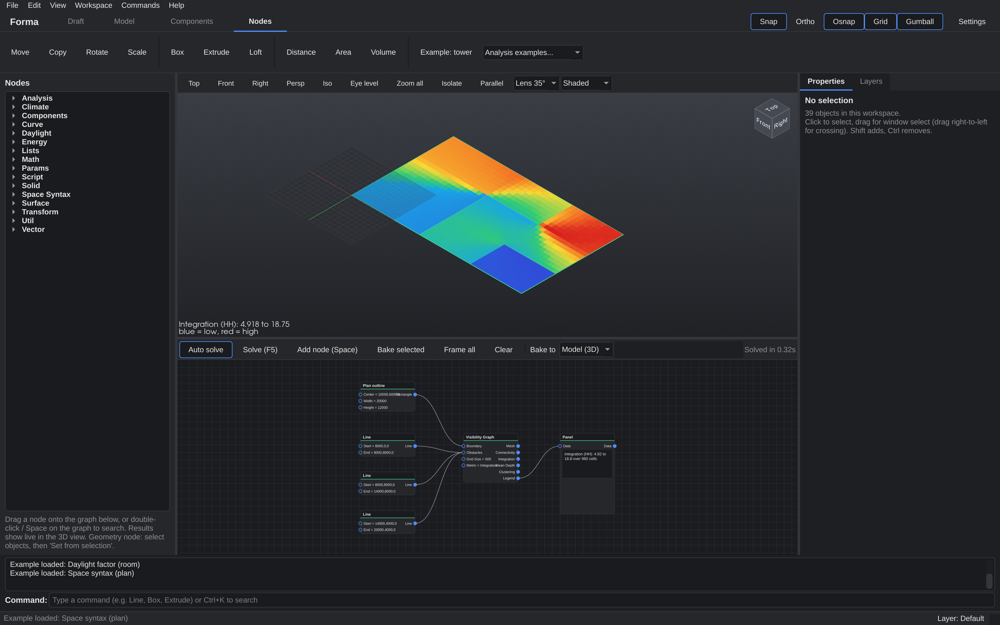 **Space syntax**: visibility graph integration | 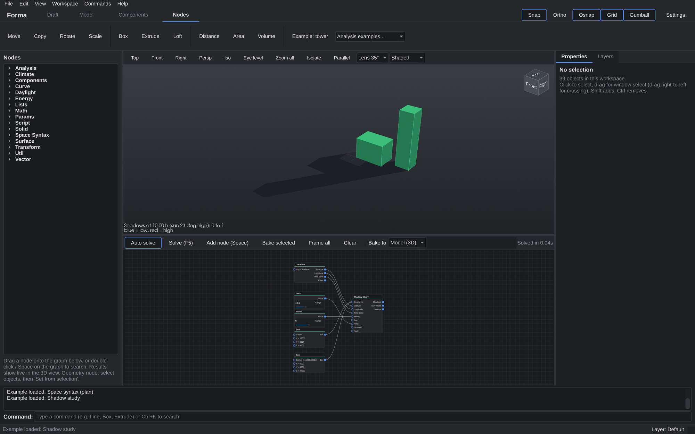 **Shadow study** |
| 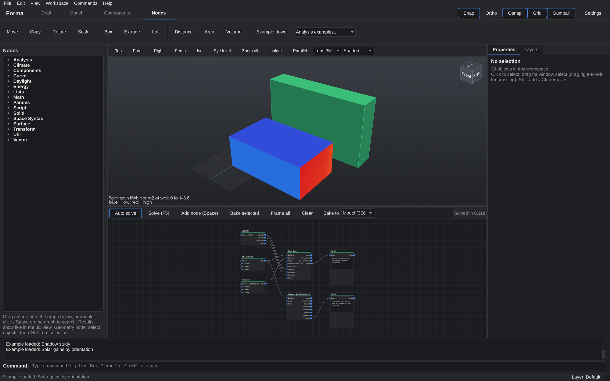 **Solar gains** by orientation | 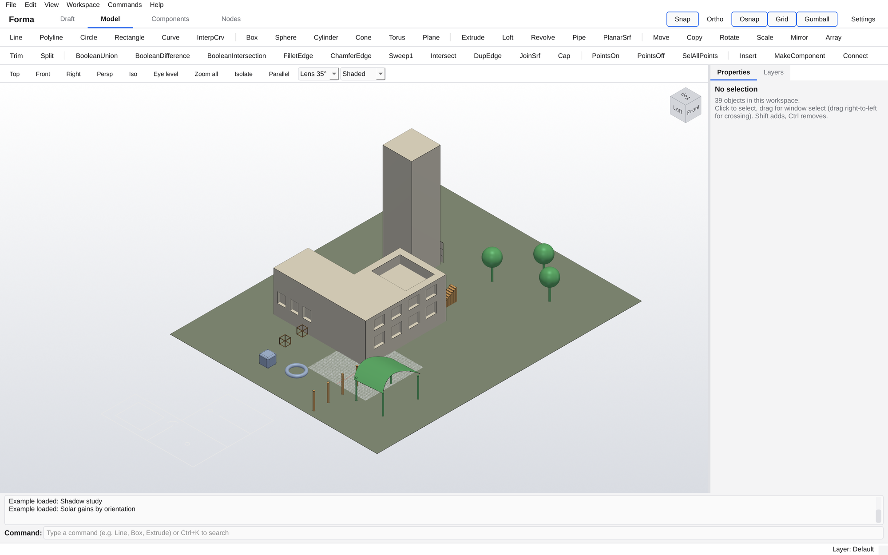 **Light theme** |

**NURBS-based.** Curves are NURBS (lines, arcs and circles convert exactly). Surfaces and solids are exact
NURBS boundary representations (B-reps) built on **OpenCascade**, the open-source kernel behind FreeCAD,
like Rhino's polysurfaces. That gives exact booleans, fillets, chamfers, trims, trimmed planar surfaces with
holes, sweeps, lofts, revolves, intersection curves, and STEP/IGES exchange. Meshes are only used for display
(and for imported meshes).

Reads and writes Rhino **.3dm** through McNeel's open-source `rhino3dm`, **STEP / IGES** through OpenCascade,
and FBX, 3DS, OBJ, DAE (SketchUp), DXF/DWG, SVG, glTF, STL and more (see the table below).

### Other ways to install (for developers)

```bash
# with pip (Python 3.10 - 3.13)
pip install git+https://github.com/catsyntax/Forma.git
forma                                   # or: python -m forma examples/sample_project.forma

# from a clone
git clone https://github.com/catsyntax/Forma.git && cd Forma
python -m venv .venv && source .venv/bin/activate   # Windows: .venv\Scripts\activate
pip install -e ".[test]"
python -m forma
python -m pytest -q tests               # core tests (no window needed)
```

On macOS you can also build a real **Forma.app** with `packaging/make_mac_app.command` after the first start.

---

## Working the way you're used to

- **Type commands anywhere.** Start typing in any view and it goes to the command line, with autocomplete.
  `Line`, `Box`, `Extrude`, `Loft`, `Move`... aliases work too (`L`, `B`, `E`, `M`).
- **Enter, Space or right-click** finishes input, or repeats the last command.
- **Esc** cancels the command or clears the selection.
- **Ctrl+K** opens a searchable command palette. **F1** lists every command and shortcut.
- **Typed coordinates:** `x,y,z` absolute · `@dx,dy` relative · `@r<angle` polar ·
  a single number = that distance along the direction your cursor is pointing.
- **F3** object snaps (End, Mid, Cen, Quad, Int, Connector) · **F7** grid · **F8** ortho · **F9** grid snap.
- **Mouse in Model:** left = select / pick, left-drag = window select (right-to-left = crossing),
  right-drag = orbit, Shift+right-drag or middle-drag = pan, wheel = zoom to cursor.
- **Orbit around the selection:** with something selected, right-drag (or trackpad swipe) turns the view around
  the selected objects or points.
- **Select one face** of a solid: **Cmd+Shift-click** (Ctrl+Shift-click) it. Drag the gumball to move that face
  (flat-faced solids), **Cmd/Ctrl-drag** an arrow to push/pull it (outward adds, inward cuts), or run **ExtractSrf**
  to copy the face out as its own surface.
- **Select one edge**: **Cmd+Option+Shift-click** (Ctrl+Alt+Shift-click) it, then drag the gumball to move it.
- **Delete or Backspace** deletes the selection. With a face, edge or points picked, it deletes just those:
  a face leaves an open polysurface, an edge removes the faces along it, a polyline segment splits the curve in
  two, and points are removed from curves and meshes (on solids, the faces touching them go). Pieces that end up
  disconnected become separate objects. Cmd+Z undoes it.
- **Isolate** (view bar, Ctrl+Shift+H, or the Isolate / Unisolate commands): show only the selected objects;
  click again to bring everything back. New objects you draw while isolated stay visible.
- **ViewCube** (top-right of every 3D view): click a face, edge or corner to fly to that view
  (26 directions, animated). Faces switch to a flat orthographic view; edges and corners stay in perspective.
- **Mouse in Draft:** scroll (wheel or two-finger) zooms at the cursor, pinch zooms, Shift+scroll or right/middle-drag pans.
- **Ctrl+Z / Ctrl+Shift+Z** undo/redo · **Ctrl+C / Ctrl+V** copy and paste in place · **Delete** deletes.

## NURBS modeling commands

**Trim** (TR): select the cutting objects, press Enter, then click each part to cut away, or drag a window
(left-to-right = parts fully inside, right-to-left = parts touched) to cut many parts at once (Enter to finish).
Works on lines, polylines, arcs, circles and NURBS curves (cut by curves), surfaces (cut by curves, e.g. a circle
makes a hole, or by other surfaces) and solids (cut by surfaces). **Split** (SP) keeps all the pieces instead.


Box, Sphere, Cylinder, Cone, TruncatedCone, Torus, Plane, PlanarSrf (inner curves become holes),
Extrude (closed curves become solids; surfaces extrude to solids), ExtrudeAlong, Loft (Normal or Straight),
Revolve, Pipe, Sweep1, BooleanUnion / Difference / Intersection (exact), FilletEdge, ChamferEdge,
Intersect (exact intersection curves), DupEdge (extract edges as NURBS curves), JoinSrf (sew surfaces;
closed results become solids), Cap (close planar holes), Explode (polysurface → surfaces),
MeshFromNurbs, Rebuild (curves), ConvertToNurbs (lines/arcs/circles → exact NURBS), Volume, Area.

Moving, rotating, copying and placing components shares the NURBS geometry instead of duplicating it,
so large modular models stay light.

## Gumball and control points

- **Gumball:** select objects (or control points) and a gumball appears. Drag an **arrow** to move along an axis,
  a **square** to move in a plane, an **arc** to rotate (Shift snaps 15°), or an **end cube** to scale along an
  axis (Shift = uniform), or the **ball half-way along an arrow** to extrude in that direction (curves become
  surfaces, closed curves and surfaces become solids, and on a solid the face pointing that way is pushed/pulled). The white dot moves freely in the view plane. **Click** a handle without dragging to type an
  exact distance, angle or factor. Hold **Option (Alt)** while dragging to make a copy; hold **Cmd or Ctrl** while
  dragging an arrow to extrude curves into surfaces and surfaces into solids along that direction. Toggle with **Gumball** in the top bar. It's in both Model (3D) and Draft (2D).
- **Control points:** **PointsOn** (F10 toggles points on and off) shows the points of curves, meshes, single untrimmed NURBS surfaces
  (lofts, planes, revolves...) and the corners of flat-faced solids (boxes, extruded polylines and their booleans;
  a face that gets bent becomes flat triangles, so the solid stays closed). Curved solids such as cylinders: Explode first. Click a point to select it, Shift-click to add, drag a box to select several,
  or **SelAllPoints**. Then drag a point directly (it snaps), use the gumball, or **Move**. **PointsOff** (F11) hides them.

## Import / export (File → Import… / Export… / Export selected…)

| Format | In | Out | Notes |
|---|---|---|---|
| .forma | ✓ | ✓ | Full project |
| .3dm (Rhino) | ✓ | ✓ | Exact NURBS faces |
| .step / .stp, .igs | ✓ | ✓ | Exact solids, best for Rhino/SolidWorks/Fusion |
| .fbx | ✓ | ✓ | 3ds Max, Maya, Blender, Unity, Unreal (binary FBX 7.4, meshes) |
| .3ds | ✓ | ✓ | 3ds Max and most tools |
| .obj | ✓ | ✓ | Y-up, with materials and curves |
| .dae (Collada) | ✓ | ✓ | **SketchUp** route (.skp is closed); Z-up with units |
| .dxf | ✓ | ✓ | AutoCAD: lines, polylines, arcs, circles, ellipses, splines, meshes, layers, blocks |
| .dwg | ✓ | ✓ | Needs the free **ODA File Converter** in Applications |
| .svg | ✓ | ✓ | Top view; SVG paths come in as exact curves |
| .glb / .gltf, .stl, .ply, .off, .3mf | ✓ | ✓ | Mesh formats (NURBS are meshed on export) |

## Components (fast modular design)

- **MakeComponent**: select objects, name it, choose a base point. The selection becomes one instance.
- **Edit once, update everywhere**: double-click an instance (or `EditComponent`). Everything else locks.
  Edit, then press *Close component*; every copy updates. *Discard changes* backs out.
- **MakeUnique** gives a copy its own definition.
- **Connectors**: components carry connection points (◆ in snaps). **Connect** snaps one component's
  connector onto another's, aligning position and rotation (press R to spin 90°).
  **Chain** grows a row of copies, each attached to the last.
- **Parametric (special) components**: built from Python with parameters (width, count, spacing...).
  Select an instance and change values in **Properties**; it rebuilds instantly.
  Starter set: Frame Module, Shelf Unit, Wall Panel, Column, Beam, Pipe Segment, Pipe Elbow,
  Panel Grid, Stair, Table, Window, Hex Tile.
- In the **Components** workspace: browse with thumbnails, try parameters on the live preview,
  set new defaults, write your own (*New parametric*), and *Save to my library* (stored in
  `~/.forma/components.json`, so they're available in every project).

## Nodes

### Analysis libraries
- **Climate:** Location (20 city presets), Sun Vector, Sun Path, Shadow Study (shadows on the ground at any hour).
- **Daylight:** Daylight Factor (CIE overcast sky component; model windows as openings), Sky View Factor,
  Sun Exposure (direct sun hours and kWh/m2 for a day), Radiation Map (annual estimate).
- **Energy:** Material (typical conductivity, density, heat capacity), U-Value (from layers), Envelope by
  Orientation (N/E/S/W wall, roof and floor areas), Solar Gains (through glazing, by month and orientation),
  Energy Balance (heat loss W/K, heating and cooling kWh).
- **Space Syntax:** Visibility Graph (integration, connectivity, mean depth, clustering), Isovist,
  Walking Distance (from entrances, around walls), Through Movement (betweenness: likely busy routes).
- **Analysis:** Color by Values (heat-map any mesh, e.g. from your own Python node).
- Ready-made graphs: **Analysis examples** in the Nodes toolbar (daylight factor of a room, shadow study,
  solar gains, space syntax, walking distance, sun hours + energy).
- All of these are early-design estimates, not certified simulations.
- Results appear as heat maps in the 3D view with a legend. Try *Example: sun + energy* in the Nodes toolbar.

- Double-click or press **Space** on the canvas to search for a node, or drag one from the left list.
- Drag from an output to an input to connect (Shift adds a second wire). Double-click an input to type a value.
- **Geometry** node: select objects in Draft or Model, then click *Set from selection*. Edits to those
  objects flow through the graph automatically.
- **Component** node places library components at points, with parameters (`width=600, shelves=4`).
- **Python** node: write any Python. Set the input and output names in its editor. `print()` goes to
  the `out` output, and `progress(0.5)` reports progress.
- Lists are matched automatically (longest list), so a list of 10 points into *Circle* makes 10 circles.
- **Every calculation runs in a separate process.** If it takes longer than a moment, a popup shows
  which node is running, with progress, elapsed time, and **Cancel** / **Cancel and disable node**.
  A frozen script never freezes the app.
- Results preview in green in the Model view. Right-click a node → *Bake* (or *Bake selected*) to add the
  results as real objects. Use *Example: tower* or *Analysis examples* in the Nodes toolbar to load working graphs.

## Settings

**Settings** (top right, or Ctrl+,): Dark / Light / Graphite themes, custom colors for the 3D background
(solid or gradient), 2D canvas, grid, accent, selection and preview; UI font size; units; grid spacing;
and when the calculation popup appears. Saved in `~/.forma/settings.json`.

## Files

- `.forma`: the full project (geometry, layers, component definitions, node graph).
- `.3dm`: import/export. NURBS faces are written as exact Rhino surfaces: untrimmed faces as NURBS
  surfaces, and planar faces as trimmed planes. The faces of each solid are grouped, so select the group in
  Rhino and run Join. Curved trimmed faces (rare, e.g. after some booleans) are written as meshes, and
  Forma tells you when that happens. Rhino breps import exactly when their faces are untrimmed or planar;
  otherwise their render meshes are used. Components export as their geometry, and Draft objects use `2D::` layers.
- `.step` / `.stp` / `.igs`: **File → Export STEP** gives fully exact solids with all trims. Rhino opens these
  perfectly, so it's the best way to send solids to Rhino. **Import STEP / IGES** brings exact solids in
  (in Rhino: Export Selected → STEP).

## Performance

- The 3D scene is drawn in a few batched GPU buffers instead of one object per item, so thousands of objects
  stay responsive. Selecting only recolours; editing one object doesn't redraw the rest.
- NURBS curves are evaluated fully vectorised (exact, including rational circles from Rhino) and drawn densely.
  Curved surfaces get smooth shading, and boxes keep their sharp edges.
- Snap points are cached between edits, and mouse moves are merged into one update per frame.
- Node calculations never block the interface.

## Honest limits (v0.3)

- Control-point editing works on curves, meshes and single untrimmed NURBS surfaces; trimmed faces and
  multi-face solids don't show points (Explode first). No network surface or Blend yet.
- Fillets use one radius for all edges; edges that can't take that radius stay sharp, and you're told.
- Make2D projects curves and mesh edges but doesn't remove hidden lines yet.
- SketchUp .skp and native 3ds Max .max are closed formats: use .dae / .fbx / .3ds / .obj.
- No dimensions/annotations or Rhino plug-in compatibility yet.

## Project layout

```
start_mac.command / start_windows.bat / start_linux.sh   one-click setup and start
main.py, forma/__main__.py   entry point (python -m forma)
forma/geometry.py            geometry kernel (curves, NURBS, meshes, transforms)
forma/brep.py                exact NURBS solids and surfaces (OpenCascade): booleans, trim, split, push/pull
forma/editpoints.py          control points, corners and faces of solids
forma/document.py            objects, layers, undo, isolation, components in the document
forma/components.py          definitions, instances, connectors, parametric library
forma/commands.py            every command (add your own with @command)
forma/interaction.py         command runner, snapping, command line
forma/view2d.py / view3d.py  the Draft and 3D viewports; gumball3d.py the 3D gumball
forma/components_ui.py       Components workspace panels
forma/nodes/                 node library, analysis libraries, solver, worker process, editor
forma/exchange.py, io3dm.py, fbx.py, max3ds.py   file import/export
forma/settings.py            themes and preferences
examples/sample_project.forma  a project with a bit of everything
tests/                       core tests, run on macOS, Windows and Linux by GitHub Actions
```

Adding a command is a few lines in `forma/commands.py`:

```python
@command("Star", ("st",), group="Draw", help="Five-pointed star.")
def cmd_star(ctx):
    c = yield GetPoint("Center")
    r = yield GetNumber("Radius", base=c)
    pts = [c + (r if i % 2 == 0 else r / 2.5) * np.array([math.cos(a), math.sin(a), 0])
           for i, a in enumerate(np.linspace(math.pi / 2, math.pi / 2 + 2 * math.pi, 10, endpoint=False))]
    ctx.commit("Star")
    ctx.new(G.polyline(pts, closed=True))
```

## Built with

[OpenCascade](https://dev.opencascade.org/) via [cadquery-ocp](https://github.com/CadQuery/OCP) (NURBS kernel),
[Qt / PySide6](https://doc.qt.io/qtforpython/), [VTK](https://vtk.org/) and [PyVista](https://pyvista.org/) (3D view),
[rhino3dm](https://github.com/mcneel/rhino3dm) (.3dm files), [trimesh](https://trimesh.org/), [ezdxf](https://ezdxf.mozman.at/),
[svgelements](https://github.com/meerk40t/svgelements), [pycollada](https://github.com/pycollada/pycollada),
[NetworkX](https://networkx.org/) and [NumPy](https://numpy.org/). Each keeps its own license.

Forma is not affiliated with McNeel, Autodesk or Trimble. Rhino, 3ds Max, AutoCAD and SketchUp are
trademarks of their owners; Forma only reads and writes their open or documented file formats.

## License

See [LICENSE](LICENSE).
